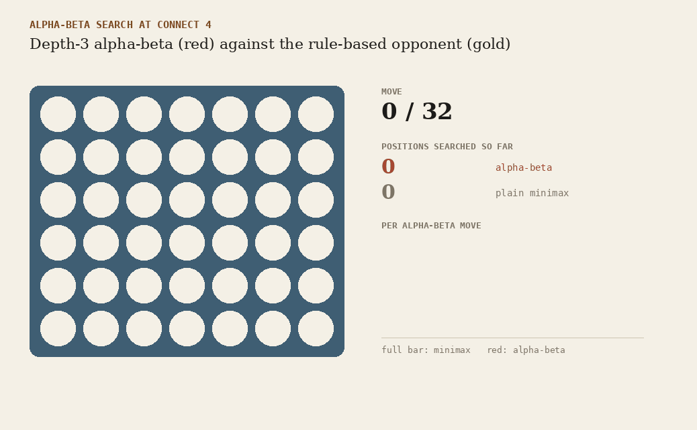
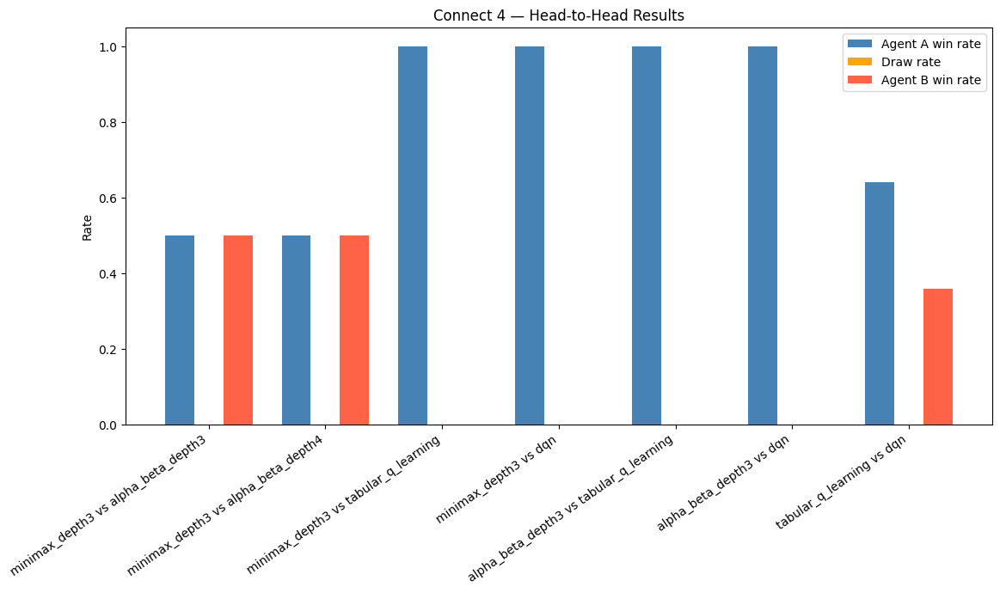
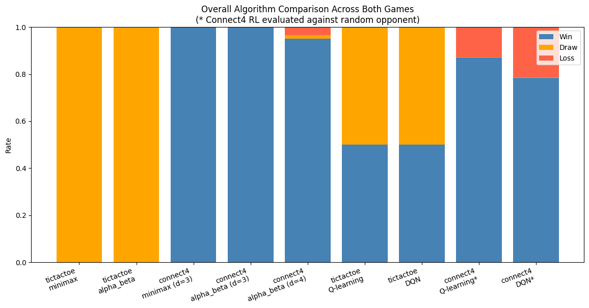

# Adversarial Search vs Reinforcement Learning

Minimax, alpha-beta pruning, tabular Q-learning and Deep Q-Networks, built from scratch and pitted against each other in Tic Tac Toe and Connect 4.

[](https://github.com/leahweldon/Adversarial-Search-vs-RL/actions/workflows/tests.yml)   

When should a game-playing agent search the game tree, and when can a learned policy compete? Tic Tac Toe is small enough to search exhaustively; Connect 4 isn't. This project implements both families of agent, trains the learners over 50,000 episodes, and evaluates everything against fixed opponents and in 100-game head-to-head matches. Individual project for CS7IS2 Artificial Intelligence at Trinity College Dublin (2026).

<p align="center">
  
</p>

*A full game of Connect 4: depth-3 alpha-beta (red) against the rule-based opponent (gold). At every turn the same position is also searched with plain Minimax; both pick identical moves, but alpha-beta searches 46% fewer positions over the game.*

## Results

**Search agents vs a rule-based opponent** (150 games each; the opponent takes winning moves and blocks threats)

| Game | Agent | Win | Draw | Nodes visited | Time / move |
|---|---|---:|---:|---:|---:|
| Tic Tac Toe | Minimax (full depth) | 0% | 100% | 30.7M | 180 ms |
| Tic Tac Toe | **Alpha-beta (full depth)** | 0% | 100% | **1.35M** | **8.6 ms** |
| Connect 4 | Minimax (depth 3) | 100% | 0% | 148k | 28 ms |
| Connect 4 | **Alpha-beta (depth 3)** | **100%** | 0% | **75k** | **15 ms** |
| Connect 4 | Alpha-beta (depth 4) | 95% | 1.7% | 562k | 61 ms |

**Reinforcement learning agents** (trained for 50,000 episodes)

| Game | Agent | Opponent | Win rate |
|---|---|---|---:|
| Connect 4 | Tabular Q-learning | Random | 87.0% |
| Connect 4 | DQN | Random | 78.4% |
| Connect 4 | Both RL agents | Depth-limited search | **0%** |
| Tic Tac Toe | DQN | Optimal search | 0% (50% draws) |
| Tic Tac Toe | Tabular Q-learning | Optimal search | 0% (13–16% draws) |

**Head to head in Connect 4** (100 games per pairing, alternating who moves first)



*Depth-limited search beat both learned agents in every game.*



## Key findings

1. **Alpha-beta pruning is free performance.** It plays identically to Minimax but visits 96% fewer nodes in Tic Tac Toe and runs about 20× faster per move.
2. **Full-depth search hits a wall in Connect 4.** After 30 minutes and more than 26 million nodes, neither Minimax nor alpha-beta finished choosing a *single* opening move, so depth limits and a heuristic evaluation (centre control and open 2- and 3-in-a-row windows) are essential.
3. **Deeper isn't always better.** Alpha-beta at depth 4 won *less* often than at depth 3 (95% vs 100%) at 4× the cost per move: more frontier positions means more accumulated error from the hand-crafted heuristic.
4. **Search dominates Connect 4.** Both RL agents beat a random player most of the time (78–87%), yet depth-3 search won every game against them. A strong win rate against a weak opponent is not the same as strong play.
5. **DQN generalises better than a lookup table.** In Tic Tac Toe, DQN held optimal search to a draw in half its games; tabular Q-learning managed draws in only 13–16%.

## How it works

| Component | Source | Notes |
|---|---|---|
| Games | [`src/games/`](src/games/) | Tic Tac Toe and Connect 4 rules, legal moves and terminal detection |
| Minimax / alpha-beta | [`src/agents/minimax_agent.py`](src/agents/minimax_agent.py) | One shared implementation with pruning on or off, so comparisons isolate the effect of pruning; records nodes, cutoffs and depth |
| Tabular Q-learning | [`src/agents/q_learning_agent.py`](src/agents/q_learning_agent.py) | Dictionary-backed Q-table with ε-greedy exploration |
| DQN | [`src/agents/dqn_agent.py`](src/agents/dqn_agent.py) | PyTorch MLP (2 × 128 hidden), experience replay, target network, ε-greedy decay |
| Opponents | [`src/agents/default_opponent.py`](src/agents/default_opponent.py), [`random_agent.py`](src/agents/random_agent.py) | Rule-based (take wins, block threats, otherwise prefer strong central squares) and random baselines |
| Training | [`src/training/`](src/training/) | Q-learning and DQN training loops |
| Evaluation | [`src/evaluation/`](src/evaluation/) | Game runner, alternating-seat matchups, aggregation |
| Experiments | [`experiments/`](experiments/) | One script per experiment, plus head-to-head suites and report figures |
| README animation | [`scripts/readme_animation.py`](scripts/readme_animation.py) | Replays the game above with the project's own agents and search statistics |

## Getting started

Requires Python 3.12+. Install a [PyTorch build](https://pytorch.org/get-started/locally/) for your machine first (CPU is fine), then:

```bash
python3 -m venv .venv
source .venv/bin/activate
pip install -r requirements.txt
python -m pytest -q tests
```

Each experiment is a module under `experiments/`, for example:

```bash
python -m experiments.run_minimax_connect4      # depth-limited search vs the rule-based opponent
python -m experiments.run_q_learning_tictactoe  # train and evaluate tabular Q-learning
python -m experiments.run_dqn_connect4          # train and evaluate the DQN
```

Training runs and full-depth search experiments take minutes to hours; the Connect 4 full-search probe deliberately runs for 30 minutes. [`readme.txt`](readme.txt) lists every experiment command. Trained models aren't stored in the repo; the training scripts regenerate them (seed 42 reproduces the report).

## Repository structure

```text
├── src/
│   ├── games/          # Tic Tac Toe and Connect 4
│   ├── agents/         # Minimax/alpha-beta, Q-learning, DQN, opponents
│   ├── training/       # Training loops
│   ├── evaluation/     # Matchups and metrics
│   └── utils/
├── experiments/        # Experiment and plotting scripts
├── scripts/            # README animation
├── tests/              # 36 unit tests
├── results/final/      # Result tables and metadata behind the report
└── docs/
    └── Adversarial-Search-vs-RL-Report.pdf
```

## Report

The full 54-page report covers the algorithms, experimental design, all results, discussion and code appendices: **[Adversarial-Search-vs-RL-Report.pdf](docs/Adversarial-Search-vs-RL-Report.pdf)**

## License

[MIT](LICENSE) © Leah Weldon
